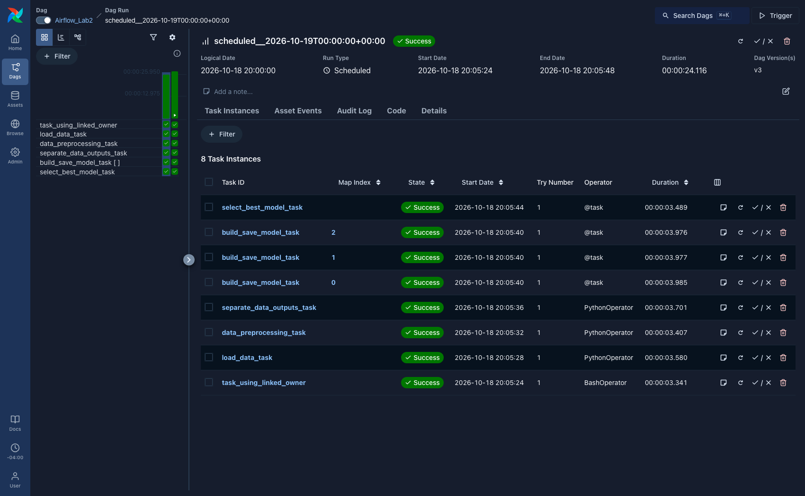
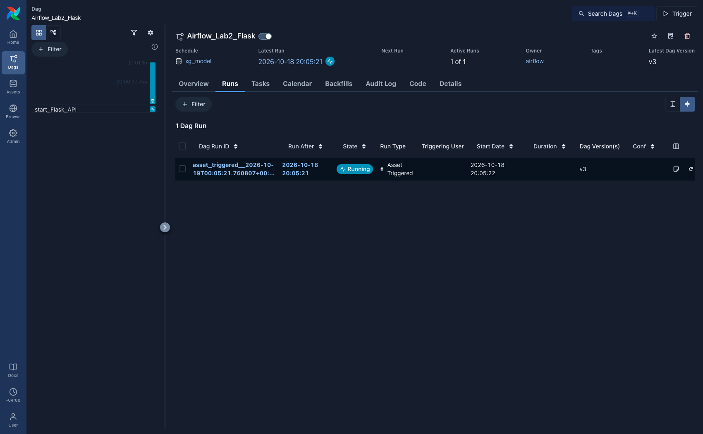
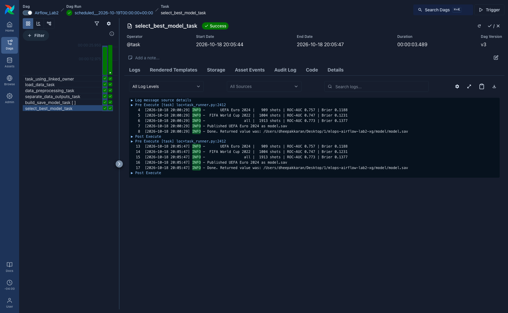
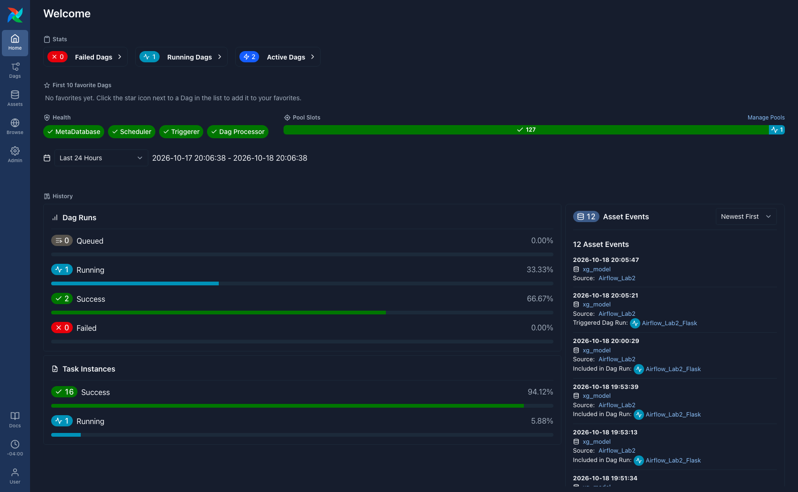

# ⚽ Airflow Lab 2: Asset-Driven xG Training Pipeline

**Lab:** Airflow Lab 2 — orchestration
**Course:** IE 7374 MLOps, Northeastern University
**Starter:** [`raminmohammadi/MLOps`](https://github.com/raminmohammadi/MLOps/tree/main/Labs/Airflow_Labs/Lab_2)

The first commit in this repository is the course lab, unmodified, so every later
diff is my own work.

---

## What the pipeline does

It trains an **expected goals (xG)** model — the probability that a shot becomes
a goal — on 2,734 non-penalty shots from the 2022 World Cup and Euro 2024, then
publishes the trained model to a second DAG that serves it over a small Flask
page.

Two DAGs:

| DAG | Role |
|---|---|
| `Airflow_Lab2` | loads shots, splits them, trains one model per competition, picks the best, publishes it |
| `Airflow_Lab2_Flask` | serves the published model; has no schedule of its own |

---

## What I changed, and why

The lab's own concept is **orchestration**, so that is where the work is. The
dataset swap is only the vehicle that carries it.

### 1. `TriggerDagRunOperator` → asset-driven scheduling

The lab chained its two DAGs by pushing:

```python
trigger_dag_task = TriggerDagRunOperator(
    trigger_dag_id="Airflow_Lab2_Flask",
    trigger_rule=TriggerRule.ALL_DONE,   # still run even if something upstream fails
)
```

`ALL_DONE` means the serving DAG started **even when training had failed**, and
then served whatever stale model happened to be on disk.

It now uses Airflow 3 data-aware scheduling. `dags/src/assets.py` declares one
asset both DAGs agree on:

```python
XG_MODEL = Asset(name="xg_model", uri="file://xg/model.sav")
```

`select_best_model_task` carries `outlets=[XG_MODEL]`, and `Airflow_Lab2_Flask`
moved from `schedule=None` to `schedule=[XG_MODEL]`. Airflow records an asset
event **only when the producing task succeeds**, so the stale-model path is
closed by construction rather than by a trigger rule. The producer no longer
knows the consumer's `dag_id` at all.

The outlet sits on the *reduce* task rather than on training, so a model is
published only after it has been evaluated.

### 2. One training task → a mapped task with a reduce step

`build_save_model_task` was one task training one model. It is now a **mapped
task** — one parallel instance per training set:

```python
build_save_model_task = build_save_model.partial(
    file_path=separate_data_outputs_task.output
).expand(training_set=TRAINING_SETS)
```

`select_best_model_task` is the **fan-in**: it compares the mapped results and
copies the winner to `model.sav`. Each mapped instance returns a small metrics
dict, not the model, so the XCom stays light; models go to disk.

### 3. Selection on calibration, not ranking

The pooled model ranks shots best but is the **worst** at being right about the
probability:

| Training set | Shots | ROC-AUC | Brier |
|---|---|---|---|
| UEFA Euro 2024 | 909 | 0.757 | **0.1188** ← published |
| FIFA World Cup 2022 | 1004 | 0.747 | 0.1231 |
| all | 1913 | **0.773** | 0.1377 |

An xG value *is* a probability, so it is judged on calibration. Selection uses
`min(brier)`, not `max(roc_auc)`. Picking on ROC-AUC would publish the
least trustworthy of the three.

### 4. `max_active_runs=1` on the serving DAG

Its task starts a server and holds a port. Two asset events produced two
concurrent runs; the first bound the port and the second could only fail with
"address already in use". The DAG now declares that it is not safe to run twice
at once.

### 5. Portability fixes

| File | Was | Now |
|---|---|---|
| `dags/src/model_development.py` | `/opt/airflow/working_data` | project root, via `LAB2_WORKING_DIR` / `LAB2_MODEL_DIR` |
| `dags/Flask_API.py` | `airflow-apiserver:8080` | `localhost:8080`, via `AIRFLOW_WEBSERVER` |
| `dags/Flask_API.py` | `port=5555` hardcoded | `LAB2_FLASK_PORT`, still defaulting to 5555 |

All three were Docker Compose assumptions. Defaults now target a plain install,
and every one is still overridable for Compose.

### 6. The dataset (the vehicle, not the contribution)

`advertising.csv` (ad click prediction, logistic regression) → 2,734 shots with
nine features, gradient boosting with balanced sample weights. `load_model`
reports ROC-AUC and Brier rather than accuracy: only 9.1% of shots are goals, so
always predicting "no goal" already scores 90.9%.

---

## Requirements

| | Version | Why it matters |
|---|---|---|
| Python | **3.12** | Airflow 3.3.2 declares `>=3.10, !=3.15`. This was built and verified on 3.12, so pass `--python 3.12` explicitly if your default `python3` is newer |
| Apache Airflow | **3.3.2** | `airflow.sdk.Asset` and `@task.expand` are Airflow 3 APIs |
| uv *(or pip)* | any | `pip` works everywhere `uv pip` appears below |

No Docker is needed. The lab's `setup.sh` (`docker compose`) is not used.

---

## Setup

```bash
git clone https://github.com/dheepakkaran/mlops-airflow-lab2-xg.git
cd mlops-airflow-lab2-xg
```

Create the environment. The constraints file pins Airflow's whole transitive
tree — installing without it is the usual cause of a broken Airflow:

```bash
uv venv --python 3.12 .venv
```

```bash
source .venv/bin/activate
```

```bash
uv pip install -r requirements.txt --constraint "https://raw.githubusercontent.com/apache/airflow/constraints-3.3.2/constraints-3.12.txt"
```

Check it:

```bash
airflow version
```

Expected: `3.3.2`

---

## Running it

### Option A — the pipeline only, no web server

Fastest way to see the whole DAG run end to end:

```bash
export AIRFLOW_HOME=$PWD/airflow_home AIRFLOW__CORE__DAGS_FOLDER=$PWD/dags AIRFLOW__CORE__LOAD_EXAMPLES=False
```

```bash
airflow db migrate
```

```bash
airflow dags test Airflow_Lab2
```

### Option B — the full stack with the UI

```bash
airflow standalone
```

The UI is at `http://localhost:8080`; the admin password is printed on first
start and written to `airflow_home/simple_auth_manager_passwords.json.generated`.

Unpause `Airflow_Lab2` and trigger it. `Airflow_Lab2_Flask` then starts **on its
own** when the model is published.

> **If ports 8080 or 5555 are already in use on your machine,** Airflow's API
> server or the Flask task will fail to bind. Both are configurable:
>
> ```bash
> export AIRFLOW__API__PORT=8081 AIRFLOW__API__BASE_URL=http://localhost:8081 AIRFLOW__CORE__EXECUTION_API_SERVER_URL=http://localhost:8081/execution/ AIRFLOW_WEBSERVER=http://localhost:8081 LAB2_FLASK_PORT=5557
> ```
>
> This is not hypothetical — both ports were occupied on the machine this was
> built on, which is why the Flask port was made configurable in the first place.

---

## What a successful run looks like

**`Airflow_Lab2` finishes with 8 task instances, all green** — note
`build_save_model_task` appearing three times, at map index 0, 1 and 2:



**`Airflow_Lab2_Flask` then starts by itself.** Its *Schedule* is `xg_model` —
not a cron — its *Run Type* is **Asset Triggered**, and *Triggering User* is
empty, because nothing pushed it:



**`select_best_model_task` logs the comparison and the decision:**



```
UEFA Euro 2024      |   909 shots | ROC-AUC 0.757 | Brier 0.1188
FIFA World Cup 2022 |  1004 shots | ROC-AUC 0.747 | Brier 0.1231
all                 |  1913 shots | ROC-AUC 0.773 | Brier 0.1377
Published UEFA Euro 2024 as model.sav
```

**The asset ties the two DAGs together** — each event names its source task and
the run it triggered:



---

## Tests

```bash
pytest tests/ -q
```

Expected: `16 passed`

The suite has two halves. `test_dag_integrity.py` pins the orchestration
decisions — no `TriggerDagRunOperator` anywhere, the outlet on the reduce task
rather than on training, the training task still mapped, the serving DAG on an
`AssetTriggeredTimetable`, `max_active_runs=1`. Revert any of those and a test
fails rather than the pipeline quietly going back to the lab's behaviour.

`test_model_development.py` covers the functions the tasks call, including that
`FEATURES` excludes `statsbomb_xg` — StatsBomb's own answer for the same shot,
which would leak straight into the label.

The tests were checked against deliberate breakage: reverting the serving DAG to
`schedule=None` fails `test_serving_dag_is_asset_scheduled`, and unmapping the
training task fails `test_training_task_is_mapped`.

`conftest.py` points `AIRFLOW_HOME` at a temporary directory, so running the
suite never touches a real Airflow instance.

---

## Project structure

| Path | What it is |
|---|---|
| `dags/main.py` | `Airflow_Lab2` — the training DAG |
| `dags/Flask_API.py` | `Airflow_Lab2_Flask` — the asset-scheduled serving DAG |
| `dags/src/assets.py` | the `xg_model` asset both DAGs share |
| `dags/src/model_development.py` | load, split, train, select |
| `dags/data/shots.csv` | 2,734 shots, 250 goals |
| `tests/` | DAG integrity and unit tests |
| `docs/images/` | the screenshots above |

---

## Features

| Feature | Meaning |
|---|---|
| `distance` | distance from the shot to the centre of the goal |
| `angle` | how wide the goal mouth looks from the shot position |
| `is_header` | the shot was a header |
| `first_time` | taken first time, without a controlling touch |
| `under_pressure` | a defender was pressing the shooter |
| `one_on_one` | the shooter was one-on-one with the keeper |
| `from_free_kick` | direct free kick |
| `from_counter` | the shot came from a counter attack |
| `from_set_piece` | the shot came from a corner, free kick or throw-in phase |

Penalties are excluded: their chance of scoring does not depend on any of this.

Shot data from [StatsBomb Open Data](https://github.com/statsbomb/open-data).
